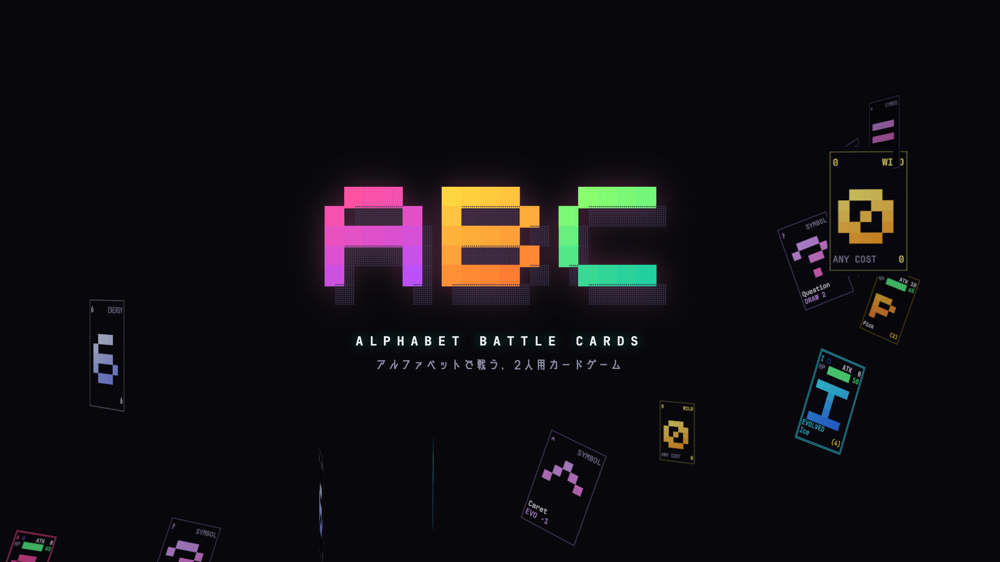
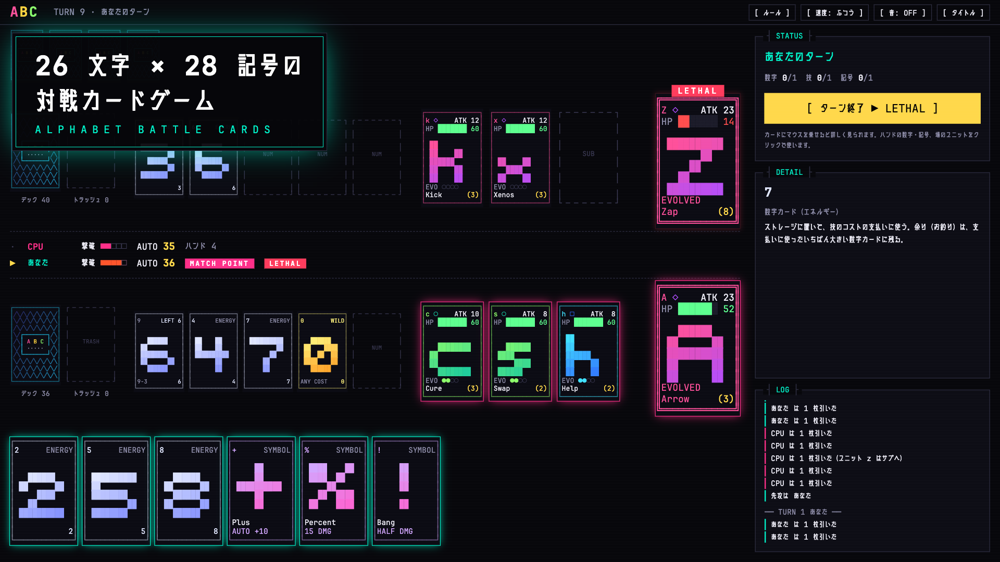
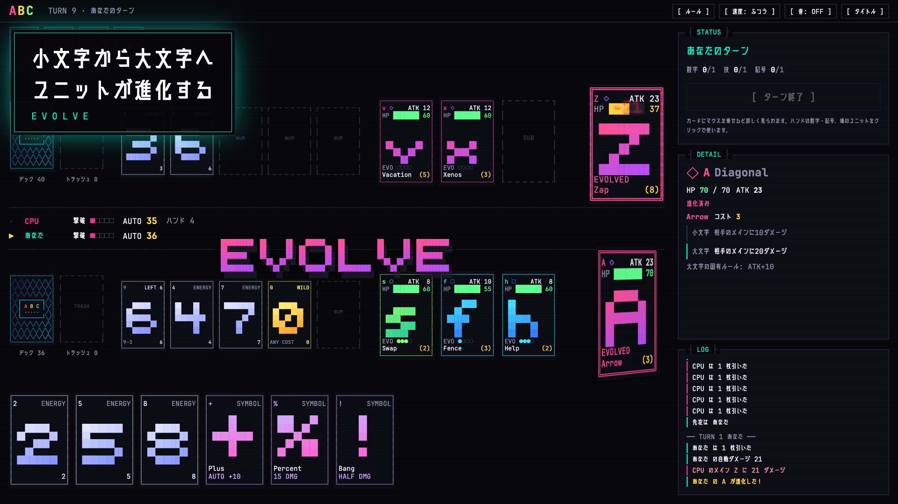
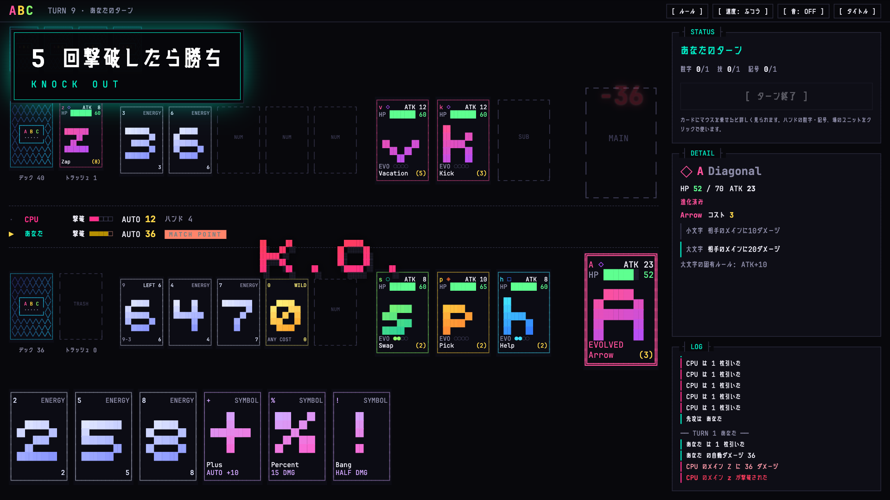
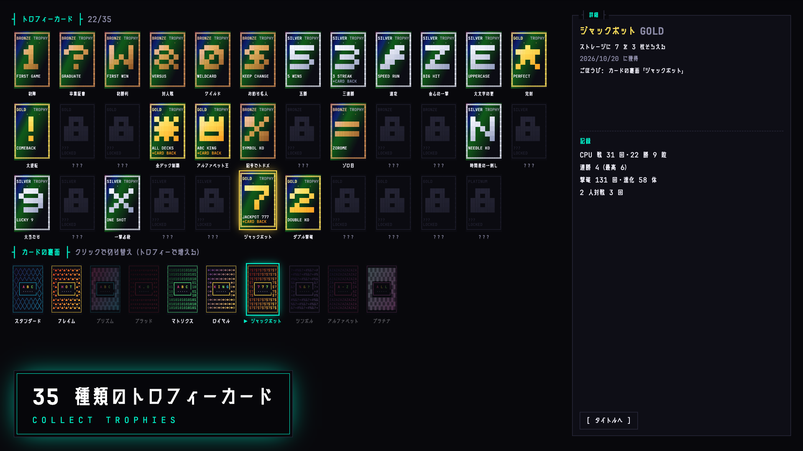

# Alphabet Battle Cards（ABC）



**アルファベットで戦う、2 人用カードゲーム。** キャラを覚える必要なし。
26 文字のアルファベットがユニットになり、数字がエネルギー、記号が特殊効果。ブラウザだけで遊べます。

## ▶ [ブラウザで遊ぶ](https://ocha-no-taiko.github.io/alphabet-battle-cards/)

インストール不要。PC のブラウザ（Chrome / Edge / Safari / Firefox の最新版）で遊べます。
1 マッチは 5〜10 分。最初は「チュートリアル」がおすすめです。

ゲームクリエイター甲子園 2026 応募作品。

## 特徴

- **カラーアスキーアート**で描いた盤面と、3D で裏返るカード
- **26 文字 × 28 記号**からデックを組む。文字の形（縦横・斜め・曲線・混合）で属性が決まる
- 小文字のユニットが場に居続けると、**大文字に進化**
- 数字で払うスキルは**お釣りあり**。0 はどんなコストでも払えるワイルドカード
- CPU 対戦・2 人対戦（同じ画面で交代）・チュートリアル
- **35 種類のトロフィーカード**と、**10 種類のカード裏面デザイン**

| | |
|---|---|
|  |  |
|  |  |

## 遊び方

| メニュー | 内容 |
|---|---|
| CPU と対戦 | 自分のデックと CPU のデックを選んで対戦 |
| 2人で対戦（同じ画面） | 1 台の PC を交代で使って対戦。番が変わるときは相手のハンドが見えないよう交代画面が出る |
| チュートリアル | 決まった展開で、ルールを 1 つずつ説明しながら遊ぶ（3〜5 分） |
| デック編集 | ユニット 7 文字と記号 13 種類を選んで保存（数字 30 枚は固定） |
| コレクション | 手に入れたトロフィーカードと記録。カードの裏面を切り替えられる |

**操作**: カードにマウスを乗せると説明が出ます。ハンドの数字をクリックでストレージに置く、記号をクリックで使う、場のユニットをクリックで技を使う。最後に「ターン終了」。
右上の「速度」で演出の速さ、「音」で音の ON / OFF を切り替えられます。

## ルール

ゲーム内の「ルール」と同じ内容です。

### 勝ち方

- 2 人で対戦します。相手のメインを 5 回撃破した側の勝ち。
- メインが撃破されたとき、サブにもハンドにもユニットがいなければ、その側の負け。

### カード（デック 50 枚）

- ユニット（アルファベット）7 枚: 戦うカード。小文字（たね）で場に出て、在籍ターンがたまると大文字に進化する。
- 数字（0〜9 を 3 枚ずつ）30 枚: ストレージに置いて、技の支払いに使う。0 は 1 枚でどんなコストも払えるワイルドカード。
- 記号 13 枚: 無料で使える特殊効果。1 ターンに 1 枚。

### 場

- メイン: 場の中心のユニット 1 枚。攻撃を受ける。
- サブ: メインの控え（最大 3 枚）。攻撃を受けない。
- ストレージ: 数字カードを置く場所（最大 5 枚、公開）。
- デックが尽きたら、トラッシュをすべてデックに戻してシャッフルする。

### 準備

- ユニット 7 枚から、メイン 1 枚とサブ 0〜3 枚を伏せて決め、同時に公開する。
- 使わないユニットはデックに混ぜてシャッフルし、5 枚引く。引いたユニットはサブに空きがあればサブへ。
- 先攻・後攻は公開のあとにランダムで決める（設定で変更可）。

### ターンの流れ

- 1. ドロー: 1 枚 + ターン開始時のサブの空きの数だけ引く。引いたユニットはサブに空きがあれば必ずサブへ。
- 2. メインフェイズ（順番は自由）: 数字カードをストレージに 1 枚置く / 技を 1 つ発動（メインかサブ 1 枚の技）/ 記号カードを 1 枚使う。
- 3. 自動ダメージ: 相手のメインに「メインのATK + サブのATK合計 × 0.5（切り上げ）」を与える。
- 4. ターン終了: 在籍ターンを足して進化の判定。Curved の大文字は HP を 2 回復。

### 技の支払い（お釣りあり）

- ストレージの数字の合計がコスト以上になるように選ぶ。余り（お釣り）は、選んだ中でいちばん大きい数字カードに「残り」として残り、次の支払いに使える。使い切ったカードだけトラッシュへ。
- 例: コスト 3 を 9 で払うと、9 は「残り 6」になってストレージに残る。続けてコスト 4 を払うと「残り 2」。
- 0 は 1 枚でどんなコストでも払えるワイルドカード（0 はお釣りなしでトラッシュへ）。
- 余分なカードは出せない（どの 1 枚を抜いても足りなくなる組み合わせだけ）。残りのあるカードがストレージを離れると、元の値に戻る。

### ダメージ

- ガードで減らす（0 未満にはならない）→「半分」の効果があれば半分（切り上げ）→ HP が 0 以下で撃破。
- 撃破された側は、サブかハンドのユニット 1 枚を新しいメインにする。撃破されたユニットはトラッシュへ（進化と在籍ターンはリセット）。

### 進化

- 自分のターン終了時、在籍ターンがメインで通算 3、サブで通算 4 に達していれば進化。メインとサブを行き来しても通算で数える。
- 進化すると HP（最大と現在）と ATK が +5、技が強化版になり、属性の固有ルールを得る。

### 属性（大文字の字形）

- □ Orthogonal（E F H I L T）: 最大HP+10
- ◇ Diagonal（A K M N V W X Y Z）: ATK+10
- ○ Curved（C O S）: 自分のターン終了時にHPを2回復
- ◈ Mixed（B D G J P Q R U）: 最大HP+5、ATK+5

### 用語

- ガードN: 次の相手ターンの間、自分のメインが受けるダメージを N 減らす。
- 封じ: 次の相手ターンの間、指定の行動ができない。「次の2ターン」は相手の次の 2 ターン。
- 探す: デックから条件に合うカードを選んでハンドに加え、デックをシャッフルする。
- 在籍ターン: メインかサブにいた自分のターンの通算数（場に出たターンも数える）。

### 自動ダメージの例

メインの ATK が 8、サブの ATK が 10 と 8 なら、8 + (10 + 8) × 0.5 = **17** を毎ターン相手のメインに与えます。
サブは攻撃を受けないので、サブを並べるほど自動ダメージが増えます。ただしサブが埋まると、ターン開始時に引く枚数は減ります。

<details>
<summary><b>ユニット 26 文字の一覧</b>（HP・ATK は 小文字 → 大文字）</summary>

| 文字 | 属性 | HP | ATK | 技（コスト） | 小文字の効果 | 大文字の効果 |
|---|---|---|---|---|---|---|
| **a → A** | ◇ Diagonal | 65 → 70 | 8 → 23 | Arrow（3） | 相手のメインに10ダメージ | 相手のメインに20ダメージ |
| **b → B** | ◈ Mixed | 70 → 80 | 10 → 20 | Boost（3） | このターン、自動ダメージを+10する | このターン、自動ダメージを+20する |
| **c → C** | ○ Curved | 60 → 65 | 10 → 15 | Cure（3） | 自分のメインのHPを15回復する | 自分のメインのHPを30回復する |
| **d → D** | ◈ Mixed | 65 → 75 | 8 → 18 | Drain（4） | 相手のメインに10ダメージを与え、同じ値だけ自分のメインを回復する | 相手のメインに20ダメージを与え、自分のメインを20回復する |
| **e → E** | □ Orthogonal | 60 → 75 | 8 → 13 | Escape（2） | ガード5 | ガード10 |
| **f → F** | □ Orthogonal | 55 → 70 | 10 → 15 | Fence（3） | ガード10 | ガード20 |
| **g → G** | ◈ Mixed | 60 → 70 | 10 → 20 | Gamble（2） | デックの一番上のカードをハンドに加える。数字カードなら、その値と同じダメージを相手のメインに与える | デックの一番上のカードをハンドに加える。数字カードなら、その値の2倍のダメージを相手のメインに与える |
| **h → H** | □ Orthogonal | 60 → 75 | 8 → 13 | Help（2） | 1枚引く | 2枚引く |
| **i → I** | □ Orthogonal | 50 → 65 | 8 → 13 | Ice（4） | 相手は記号カードを使えない（次の相手ターン） | 相手は記号カードを使えない（次の2ターンの間） |
| **j → J** | ◈ Mixed | 55 → 65 | 12 → 22 | Jinx（3） | 相手の技のコストを2増やす（次の相手ターン） | 相手の技のコストを4増やす（次の相手ターン） |
| **k → K** | ◇ Diagonal | 60 → 65 | 12 → 27 | Kick（3） | 相手のストレージの数字カード1枚を、トラッシュさせる | 相手のストレージの数字カード2枚を、トラッシュさせる |
| **l → L** | □ Orthogonal | 55 → 70 | 8 → 13 | Lock（4） | 相手は数字カードをストレージに置けない（次の相手ターン） | 相手は数字カードをストレージに置けない（次の2ターンの間） |
| **m → M** | ◇ Diagonal | 70 → 75 | 10 → 25 | Muscle（4） | 相手のメインに15ダメージ | 相手のメインに30ダメージ |
| **n → N** | ◇ Diagonal | 60 → 65 | 8 → 23 | Needle（3） | 次の相手ターンの終了時に、相手のメインに10ダメージ | 次の相手ターンの終了時に、相手のメインに20ダメージ |
| **o → O** | ○ Curved | 65 → 70 | 8 → 13 | Orbit（2） | 自分のトラッシュの数字カード1枚を、ハンドに戻す | 自分のトラッシュの数字カード2枚を、ハンドに戻す |
| **p → P** | ◈ Mixed | 65 → 75 | 10 → 20 | Pick（2） | デックから数字カードを1枚探して、ハンドに加える | デックから数字カードを2枚探して、ハンドに加える |
| **q → Q** | ◈ Mixed | 65 → 75 | 12 → 22 | Quest（3） | デックから記号カードを1枚探して、ハンドに加える | デックから記号カードを2枚探して、ハンドに加える |
| **r → R** | ◈ Mixed | 65 → 75 | 8 → 18 | Reflect（4） | 次の相手ターン、自分のメインが受けるダメージの半分を、相手のメインにも与える | 次の相手ターン、自分のメインが受けるダメージと同じ値を、相手のメインにも与える |
| **s → S** | ○ Curved | 60 → 65 | 8 → 13 | Swap（2） | 自分のメインとサブ1枚を入れ替える | 自分のメインとサブ1枚を入れ替えたあと、新しいメインのHPを10回復する |
| **t → T** | □ Orthogonal | 60 → 75 | 8 → 13 | Tough（5） | ガード20 | ガード25 |
| **u → U** | ◈ Mixed | 60 → 70 | 8 → 18 | Undo（5） | 自分のトラッシュのユニット1体を、小文字の状態でHP半分で、サブの空きに出す（空きがなければハンドに加える） | 自分のトラッシュのユニット1体を、小文字の状態でHP満タンで、サブの空きに出す（空きがなければハンドに加える） |
| **v → V** | ◇ Diagonal | 60 → 65 | 12 → 27 | Vacation（5） | 相手のメインは技を使えない（次の相手ターン） | 相手のメインは技を使えない（次の2ターンの間） |
| **w → W** | ◇ Diagonal | 70 → 75 | 10 → 25 | Warp（4） | 相手のサブ1枚を選び、相手のメインと入れ替える | 相手のサブ1枚を選び、相手のメインと入れ替えたあと、新しいメインに10ダメージ |
| **x → X** | ◇ Diagonal | 60 → 65 | 12 → 27 | Xenos（3） | 相手のメインの進化までの残りターン数を1増やす | 相手のメインの進化までの残りターン数を2増やす |
| **y → Y** | ◇ Diagonal | 60 → 65 | 10 → 25 | Yank（3） | 相手のハンドからランダムに1枚を、トラッシュさせる | 相手のハンドからランダムに2枚を、トラッシュさせる |
| **z → Z** | ◇ Diagonal | 60 → 65 | 8 → 23 | Zap（8） | 相手のメインに20ダメージ | 相手のメインに40ダメージ |

</details>

<details>
<summary><b>記号 28 種類の一覧</b>（無料・1 ターン 1 枚）</summary>

| 記号 | 名前 | 効果 |
|---|---|---|
| `+` | Plus | このターン、自動ダメージを+10する |
| `-` | Minus | 次の相手ターン、相手の自動ダメージを-10する |
| `*` | Asterisk | このターン、サブ倍率を0.5から1にする |
| `/` | Slash | 次の相手ターン、相手のサブ倍率を0にする |
| `%` | Percent | 相手のメインに15ダメージ |
| `^` | Caret | 自分のメインの進化までの残りターン数を1減らす |
| `=` | Equal | ストレージの数字カード1枚を、ハンドに戻す |
| `~` | Tilde | ハンドをすべてデックに戻してシャッフルし、同じ枚数を引く |
| `!` | Bang | 次の相手ターン、自分のメインが受けるダメージを半分にする |
| `( )` | Parens | 次の相手ターン、自分のストレージの数字カードをトラッシュされないようにする |
| `[ ]` | Brackets | ハンドのユニット1枚と、サブのユニット1枚を入れ替える |
| `{ }` | Braces | 自分のメインのHPを10回復する |
| `< >` | Angles | 自分のメインと相手のメインの現在HPを入れ替える（最大HPは超えない） |
| `\|` | Bar | 次の相手ターン、相手は記号カードを使えない |
| `&` | Ampersand | このターン、技をもう1つ発動できる（コストは別に払う） |
| `?` | Question | デックから2枚引く |
| `:` | Colon | デックからユニットを1枚探して、ハンドに加える |
| `;` | Semicolon | このターン、記号カードをあと1枚使える（「;」自体は1枚に数えない） |
| `@` | At | 相手のハンドを見て、1枚をトラッシュさせる |
| `#` | Hash | このターン、ストレージの数字カード1枚の値を+2として扱う（0は対象外） |
| `$` | Dollar | このターン、数字カードをもう1枚ストレージに置ける（上限の5枚は変わらない） |
| `¥` | Yen | トラッシュの数字カード1枚を、ハンドに戻す |
| ``` | Backtick | トラッシュの記号カード1枚を、ハンドに戻す |
| `'` | Apostrophe | このターン使う技のコストを3減らす |
| `"` | Quote | デックから数字カードを1枚探して、ハンドに加える |
| `,` | Comma | ハンドのカード1枚をトラッシュして、1枚引く |
| `.` | Period | 自分にかかっている相手の妨害（封じ・コスト増加・継続ダメージ）を、すべて終わらせる |
| `_` | Underscore | 次の自分のターン終了時まで、ストレージの上限を+1する |

</details>

## クレジット

- フォント: [JetBrains Mono](https://www.jetbrains.com/lp/mono/)（SIL OFL 1.1）、[廻想体 ネクストUP](https://moji-waku.com/kaiso/)（もじワク研究）、[UDEV Gothic](https://github.com/yuru7/udev-gothic)（SIL OFL 1.1）
- 3D 表示: [three.js](https://threejs.org/)（MIT）

開発者向けの説明（動かし方・データの編集・シミュレーション）は [docs/DEVELOPMENT.md](docs/DEVELOPMENT.md) にあります。
